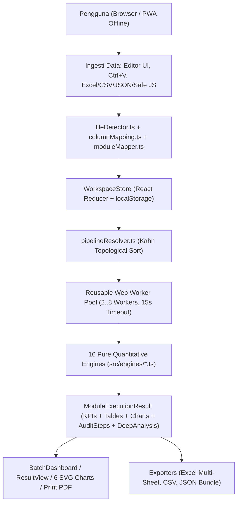

# Product Requirements Document (PRD) — OmniQM Studio

| Atribut | Nilai |
| :--- | :--- |
| **Nama Produk** | **OmniQM Studio** — Workbench POM-QM & PPIC Multi-Modul Paralel |
| **Versi Dokumen** | `1.0.0` (Baseline Produk Terverifikasi) |
| **Status Produk** | Production-Ready (16 Modul Aktif, 73/73 Tes Lulus, CI Hijau) |
| **Repositori** | [Oceppppp/omniqm-studio](https://github.com/Oceppppp/omniqm-studio) |
| **Arsitektur & Desain** | [`docs/ARCHITECTURE.md`](ARCHITECTURE.md) · [`docs/DESIGN_SYSTEM.md`](DESIGN_SYSTEM.md) |
| **Dokumen Terkait** | [`docs/PROJECT_PLANNING.md`](PROJECT_PLANNING.md) |

---

## 1. Ringkasan Eksekutif & Visi Produk

### 1.1 Latar Belakang & Pernyataan Masalah (*Problem Statement*)
Perangkat lunak riset operasi dan *Production & Operations Management* klasik (seperti POM-QM for Windows) masih menjadi standar pembelajaran di perkuliahan Teknik Industri, Manajemen Operasi, dan PPIC (*Production Planning and Inventory Control*), namun memiliki lima keterbatasan struktural dalam praktik modern:

1. **Eksekusi Terisolasi Satu Modul per Jendela:** Pengguna tidak dapat mengeksekusi berbagai model (misalnya Forecasting, Aggregate Planning, MRP, EOQ, dan Scheduling) secara serentak untuk mengevaluasi satu skenario operasional yang utuh.
2. **Input Manual Sel demi Sel:** Memasukkan matriks berulang secara manual rawan kesalahan ketik dan memperlambat pengolahan dataset nyata dari Excel, CSV, atau skrip data JavaScript/JSON.
3. **Tidak Ada Integrasi Aliran Data Antar-Modul:** Output peramalan permintaan (*Forecasting*) tidak dapat dialirkan secara otomatis menjadi *demand* pada Perencanaan Agregat (MPS), *Gross Requirements* pada MRP, atau permintaan tahunan pada EOQ.
4. **Keluaran Angka Mentah Tanpa Interpretasi Manajerial:** Pengguna sering menerima tabel solusi optimal tanpa penjelasan konteks bisnis (kendala mana yang menjadi *bottleneck*, makna *shadow price*, tingkat *integrality gap*, atau langkah tindak lanjut operasional).
5. **Ketergantungan Sistem Operasi Desktop:** Aplikasi legacy terbatas pada lingkungan Windows lokal, sulit dibagikan lintas perangkat (macOS, Linux, tablet), dan tidak mendukung pembaruan otomatis lewat web/PWA.

### 1.2 Visi Produk & Proporsi Nilai
**OmniQM Studio** adalah *Precision Analytical Workbench* berbasis web 100% sisi klien (*client-side*) yang mengimplementasikan **16 modul kuantitatif POM-QM & PPIC** dalam satu antarmuka analitik profesional dengan empat pilar nilai utama:

- **Paralelisme Instan:** Mengeksekusi seluruh 16 modul bersamaan melalui *Reusable Web Worker Pool* tanpa memblokir antarmuka pengguna.
- **Keterhubungan Rantai PPIC (DAG Pipeline):** Menautkan keluaran satu modul menjadi masukan modul hilir menggunakan penjadwalan topologis (*Kahn's Algorithm*), lengkap dengan *Preset Rantai PPIC 5-Tahap*.
- **Ingesti Data Universal & Aman:** Menerima workbook Excel multi-sheet (`.xlsx`/`.xls`), banyak file `.csv`, bundel proyek `.omniqm.json`, file JavaScript (`.js`/`.mjs`/`.cjs` dengan nama & pola ekspor bebas tanpa `eval()`), serta tempel langsung (`Ctrl+V`) dari Excel/Google Sheets.
- **Transparansi Matematis & Analisis Mendalam:** Setiap modul menghasilkan metrik KPI terstruktur, jejak langkah perhitungan & rumus (`auditSteps`), visualisasi SVG terkalibrasi, serta narasi `DeepAnalysis` berbasis angka aktual yang ikut terekspor ke Excel, CSV, dan mode cetak/PDF.

### 1.3 Indikator Keberhasilan Produk (*Product KPIs*)

| Metrik Keberhasilan | Target PRD | Realisasi v1.0.0 |
| :--- | :--- | :--- |
| Cakupan modul kuantitatif POM-QM & PPIC | 16 modul inti tervalidasi | **16 / 16 modul** |
| Waktu eksekusi batch 16 modul simultan | `< 500 ms` (target ideal `< 300 ms`) | **`167–243 ms`** (Chromium headless) |
| Akurasi & stabilitas matematis otomatis | 100% tes lulus, 0 error lint/typecheck | **73 / 73 tes lulus**, 0 lint/tsc error |
| Kelengkapan analisis manajerial (`DeepAnalysis`) | 100% modul memiliki narasi & rekomendasi | **16 / 16 modul** (UI, Excel, CSV, Print) |
| Kemampuan berjalan offline (PWA) | 100% fungsional tanpa koneksi internet | **Penuh** (*Full Bundle Precaching* `sw.js`) |
| Ketergantungan backend / pengiriman data sensitif | 0 byte data dikirim ke server eksternal | **100% client-side** |

---

## 2. Target Pengguna, Persona & User Stories

### 2.1 Persona Pengguna

| ID | Persona | Profil & Konteks Penggunaan | Kebutuhan Utama |
| :--- | :--- | :--- | :--- |
| **P1** | **Mahasiswa Teknik Industri / Manajemen Operasi** | Mengerjakan praktikum, tugas besar, dan UAS PPIC / Riset Operasi dengan berbagai modul sekaligus. | Input cepat dari Excel/CSV, jejak langkah rumus untuk verifikasi jawaban manual, grafik siap cetak PDF, dan penjelasan makna hasil. |
| **P2** | **Dosen & Asisten Laboratorium** | Menyiapkan studi kasus, mendemonstrasikan keterkaitan rantai PPIC di kelas, dan memeriksa variasi parameter (*What-If*). | Akses langsung di browser lintas OS tanpa instalasi, preset 16 modul & PPIC 5-tahap, komparasi skenario *Baseline vs What-If*, dan akurasi standar buku teks. |
| **P3** | **Perencana Produksi & Analis Supply Chain SME** | Mengolah data permintaan, kapasitas produksi, BOM material, persediaan, dan jadwal mesin di skala usaha kecil-menengah. | Upload data multi-format secara lokal (privasi terjaga), ekspor laporan eksekutif Excel siap presentasi, dan rekomendasi operasional yang langsung dapat dieksekusi. |

### 2.2 Daftar User Stories Utama

| ID | Persona | User Story | Referensi Kebutuhan |
| :--- | :--- | :--- | :--- |
| `US-01` | P1, P2 | Sebagai pengguna, saya ingin membuka dan menjalankan seluruh 16 modul POM-QM sekaligus dalam satu klik agar bisa melihat ringkasan KPI semua kasus tanpa berpindah jendela. | `FR-01`, `FR-02` |
| `US-02` | P1, P3 | Sebagai perencana PPIC, saya ingin menautkan hasil Forecasting ke Aggregate Planning, MRP, Inventory, hingga Scheduling agar perubahan permintaan langsung merambat ke seluruh rantai pasok. | `FR-03` |
| `US-03` | P1, P3 | Sebagai analis data, saya ingin mengunggah 1 file Excel multi-sheet, banyak CSV, JSON, atau file JS bebas — atau menempel langsung (`Ctrl+V`) dari Excel — lalu memetakan kolomnya bila header berbeda. | `FR-04` |
| `US-04` | P1, P2 | Sebagai mahasiswa/dosen, saya ingin membaca interpretasi mendalam, diagnosa kendala/risiko, rekomendasi konkret, dan langkah rumus perhitungan pada setiap modul agar tidak hanya melihat angka akhir. | `FR-05` |
| `US-05` | P2, P3 | Sebagai pengambil keputusan, saya ingin menyimpan *Baseline Snapshot* lalu mengubah parameter input untuk melihat selisih (`Δ` dan `%`) secara berdampingan (*What-If Analysis*). | `FR-02` |
| `US-06` | P1, P3 | Sebagai pengguna, saya ingin mengekspor seluruh hasil batch ke 1 file Excel multi-sheet (berikut analisis mendalam), CSV, bundel proyek `.omniqm.json`, atau mencetaknya ke PDF dengan grafik yang rapi. | `FR-06`, `FR-07` |
| `US-07` | P1, P2 | Sebagai pengguna di ruang kelas/lab tanpa internet stabil, saya ingin aplikasi tetap dapat dibuka dan dihitung secara penuh dalam mode offline dan menyimpan progres kerja di browser. | `FR-08` |

---

## 3. Ruang Lingkup Produk (*Scope & Boundaries*)

### 3.1 Termasuk dalam Ruang Lingkup (*In-Scope* — v1.0.0)
- Implementasi murni TypeScript (Web-Worker-safe) untuk **16 modul kuantitatif POM-QM & PPIC**.
- **Batch Execution Engine** berbasis *Reusable Web Worker Pool* + *Pipeline DAG Resolver*.
- **Universal File Ingestion** (`.xlsx`, `.xls`, `.csv`, `.json`, `.omniqm.json`, `.js`, `.mjs`, `.cjs`, teks terstruktur) dengan deteksi modul otomatis dan *Interactive Column Mapping Wizard*.
- **Direct Spreadsheet Paste (`Ctrl+V`)** pada editor matriks dan tabel.
- **Deep Analysis (`DeepAnalysis`)** dan **Audit Trail (`AuditStep`)** untuk seluruh 16 modul.
- **6 Visualisasi SVG Murni** (Line, Bar, Gantt, LP 2D Feasible Region, Network AON/Graf, Pipeline DAG).
- **Ekspor Multi-Format** (Excel multi-sheet + Master Template 16 sheet, CSV, JSON Project Bundle, Print/PDF).
- **PWA Offline & Auto-Deploy Netlify** dengan *cache busting* otomatis per build.

### 3.2 Di Luar Ruang Lingkup (*Out-of-Scope* — v1.0.0)
- Backend database terpusat, sistem autentikasi akun/RBAC, atau sinkronisasi kolaborasi *real-time* antar pengguna.
- Optimasi MILP skala industri masif (`> 10.000` variabel/kendala) yang memerlukan solver biner eksternal/WASM khusus (direncanakan pada roadmap v2.0).
- Koneksi API langsung ke sistem ERP komersial (SAP, Oracle NetSuite, Odoo).
- Modul non-inti seperti Simulasi Monte Carlo, *Facility Location/Layout*, dan *Line Balancing* (direncanakan pada roadmap v1.2).

---

## 4. Kebutuhan Fungsional (*Functional Requirements*)

### FR-01: 16 Modul Solver Kuantitatif POM-QM & PPIC
Sistem wajib menyediakan 16 modul independen yang terdaftar terpusat di [`src/core/registry/moduleRegistry.ts`](../src/core/registry/moduleRegistry.ts) dengan kontrak input/output bertipe ketat di [`src/core/types/module.types.ts`](../src/core/types/module.types.ts).

| Kode | ID Modul | Kategori | Algoritma & Fitur Wajib | Proteksi Edge-Case & Validasi | Output Pipeline (`derivedValues`) |
| :--- | :--- | :--- | :--- | :--- | :--- |
| `LP` | `linear-programming` | Optimization | Two-Phase Simplex + anti-cycling Bland; Shadow Price eksak (`<=`, `>=`, `=`); Ranging/Sensitivity Analysis (Koefisien Z & RHS); Jejak tabel simpleks; Plot Feasible Region 2D. | Deteksi infeasible, unbounded, RHS negatif otomatis dibalik, solusi dual eksak `y = c_B · B⁻¹` untuk kendala `=`. | `optimalZ` |
| `IP` | `integer-programming` | Optimization | Best-First Branch-and-Bound untuk variabel `continuous`, `integer`, dan `binary` (0/1); perbandingan relaksasi LP & *Integrality Gap*. | Batas node eksplorasi aman anti-hang, penanganan relaksasi infeasible/unbounded. | `optimalZ` |
| `TR` | `transportation` | Optimization | Auto-balancing Dummy Source/Destination; solusi awal VAM (*Vogel's Approximation Method*); optimasi MODI (*Modified Distribution*); perbandingan VAM vs Optimal. | Detektor siklus berbasis *Disjoint Set Union (Union-Find)* untuk tahan kasus *degeneracy* (`m + n - 1` sel basis). | `totalCost` |
| `AS` | `assignment` | Optimization | Algoritma Hungarian $O(n^3)$ untuk objektif `min` dan `max`. | Dukungan matriks persegi & non-persegi (padding dummy otomatis) serta nilai biaya/profit negatif. | `totalCost` |
| `PM` | `project-management` | Project & Network | Mode CPM & PERT ($t_e$, $\sigma^2$, $Z$-score probabilitas target); Forward/Backward Pass (ES/EF/LS/LF/Slack); Project Crashing (*Time-Cost Trade-Off*); Gantt & Diagram AON SVG. | Deteksi siklus aktivitas, enumerasi seluruh jalur kritis paralel, variansi jalur kritis maksimum, dan *multi-node crashing cut* saat jalur paralel aktif. | `projectDuration` |
| `FC` | `forecasting` | Forecasting & Decision | Naive, SMA, WMA, Single Exponential Smoothing, Holt's Linear Trend, Seasonal Decomposition / Holt-Winters (Additive & Multiplicative), Regresi Linear ($R^2$), Auto-Tune $(\alpha,\beta)$, evaluasi MAD/MSE/MAPE/Bias/Tracking Signal. | Normalisasi bobot WMA saat jendela terpotong, guard nilai aktual 0 pada MAPE, proyeksi multi-horizon. | `nextPeriodForecast`, `annualizedForecast12`, `horizonForecasts` |
| `IN` | `inventory` | Operations & Inventory | EOQ, POQ (produksi bertahap $p > d$), Quantity Discount bertingkat (*all-units*), Reorder Point & Safety Stock ($z\sigma\sqrt{L}$), Klasifikasi Pareto ABC. | Validasi $p > d$ pada POQ, penyertaan biaya pembelian penuh pada `totalInventoryCost` Quantity Discount. | `optimalQ`, `totalInventoryCost` |
| `WL` | `waiting-lines` | Operations & Inventory | M/M/1, M/M/s (Erlang-C), M/M/1/K (kapasitas terbatas), M/D/1; analisis biaya tunggu vs biaya server + rekomendasi jumlah server optimal $s^*$. | Perhitungan rekursif rasio tahan *factorial overflow* untuk $s$ besar, validasi stabilitas $\rho < 1$, dukungan `timeUnit` asli. | `wq`, `totalCost` |
| `BE` | `break-even` | Operations & Inventory | BEP Unit & Pendapatan, Target Laba, Margin of Safety (Unit & %), Degree of Operating Leverage (DOL), Analisis Crossover multi-alternatif proses. | Guard margin kontribusi $P \le VC$, penghitungan interval dominasi yang akurat pada analisis Crossover. | `bepUnits` |
| `DA` | `decision-analysis` | Forecasting & Decision | Maximax/Minimin, Maximin/Minimax, Hurwicz ($\alpha$), Laplace, Minimax Regret, EMV, EOL, dan EVPI. | Penyesuaian label & arah optimasi otomatis untuk tabel biaya (`isCostTable: true`) vs tabel payoff/laba, normalisasi probabilitas. | `bestEmv`, `evpi` |
| `QC` | `quality-control` | Quality & Scheduling | Peta kendali $\bar{X}$-$R$ (konstanta ASTM penuh $n=2..25$), $p$-Chart, $c$-Chart; deteksi *Out-of-Control* & Western Electric Run Rule; kapabilitas $C_p/C_{pk}$ & estimasi defect PPM. | Validasi `USL > LSL`, batas bawah `LCL ≥ 0` dan `UCL ≤ 1` pada $p$-Chart, sinkronisasi otomatis ukuran subgrup. | `outOfControlCount` |
| `NM` | `network-models` | Project & Network | Shortest Route (Bellman-Ford), Minimum Spanning Tree (Kruskal), Maximal Flow (Edmonds-Karp) + visualisasi graf. | Deteksi siklus bobot negatif pada Bellman-Ford, verifikasi konektivitas hanya pada node ber-edge di MST, pembuktian Teorema Max-Flow = Min-Cut. | `shortestDistance`, `mstWeight`, `maxFlow` |
| `MK` | `markov-analysis` | Forecasting & Decision | Simulasi distribusi $n$-langkah, Steady-State Ergodik + jarak konvergensi $L_1$, Rantai Absorbing (Matriks Fundamental $N = (I-Q)^{-1}$ dan Matriks Absorpsi $B = NR$). | Deteksi seluruh state absorbing, guard matriks $(I-Q)$ singular, dan proyeksi probabilitas absorpsi langsung dari vektor awal $\pi_0$. | *(tabel & grafik transisi)* |
| `MR` | `mrp` | Operations & Inventory | Ledakan BOM Multi-Level & Multi-Parent (*Low-Level Coding*); Scheduled Receipts, Safety Stock, POH, Net Requirements, PORc, PORel; 5 metode Lot-Sizing (`L4L`, `FOQ`, `POQ`, `EOQ`, `SM`/Silver-Meal) + tabel perbandingan total biaya otomatis. | Deteksi dan peringatan rambatan *Past-Due* dari induk ke komponen anak; proteksi siklus BOM. | `totalPlannedReleases`, `level0PlannedReleases` |
| `AP` | `aggregate-planning` | Operations & Inventory | Evaluasi & perbandingan 4 strategi sekaligus: Chase, Level, Mixed, dan Optimal Transportation Method (Bowman LP). | Penalti *shortage/backorder* multi-periode akurat $(T-t) \cdot b$ pada formulasi Bowman LP, kalkulasi kapasitas reguler/lembur/subkontrak & biaya rekrut/PHK. | `lowestTotalCost`, `mpsProductionSchedule`, `totalDemandHorizon` |
| `SC` | `scheduling` | Quality & Scheduling | Single-Machine (komparasi serentak FCFS, SPT, LPT, EDD, CR dengan metrik Flow Time, Tardiness, Max Tardiness, Utilization, WIP) & Algoritma Johnson 2-Mesin lengkap dengan Gantt Chart. | Penanganan *due date* ketat & identifikasi urutan optimal minimasi *makespan* pada Johnson 2-Mesin. | `bestFlowTime`, `makespan` |

### FR-02: Eksekusi Batch Paralel & Simulasi *What-If*
- **Worker Pool Persisten ([`workerPool.ts`](../src/workers/workerPool.ts)):** Menjalankan modul independen dalam satu tahap secara paralel menggunakan jumlah worker `max(2, min(hardwareConcurrency, 8))`, batas timeout `15.000 ms` per tugas, pemulihan otomatis saat worker error, serta fallback sinkron aman pada lingkungan non-Worker (seperti pengujian unit Vitest).
- **Master Batch Matrix ([`BatchDashboard.tsx`](../src/ui/components/BatchDashboard.tsx)):** Menampilkan seluruh hasil dalam satu tabel eksekutif otoritatif berisi kode modul, nama pekerjaan, status, KPI utama, ringkasan, durasi (`ms`), filter pencarian/status, serta ekspansi *inline detail drawer* (`tr.batch-detail-row`) langsung di bawah baris terpilih tanpa duplikasi daftar kartu.
- **Simulasi Multi-Skenario (*What-If*):** Pengguna dapat menyimpan *Baseline Snapshot* (`ScenarioSnapshot`), menduplikasi pekerjaan, mengubah input, menjalankan ulang batch, dan melihat tabel selisih KPI absolut (`Δ`) maupun persentase (`%`) dibandingkan baseline.

### FR-03: Pipeline Integrasi Antar-Modul (DAG)
- **Topologi & Penjadwalan ([`pipelineResolver.ts`](../src/core/pipeline/pipelineResolver.ts)):** Menggunakan algoritma Kahn untuk mempartisi pekerjaan aktif menjadi tahapan eksekusi berurutan (*Stage 1, Stage 2, ...*) di mana seluruh pekerjaan dalam tahap yang sama dieksekusi paralel. Sistem mendeteksi siklus dependensi (`hasCycle`) dan memberi peringatan tanpa menggagalkan seluruh batch.
- **Injeksi Parameter Skalar & Deret Array:** Mendukung pemetaan output skalar (misalnya `Forecasting.annualizedForecast12 → Inventory.annualDemand`) maupun deret multi-periode (misalnya `Forecasting.horizonForecasts → AggregatePlanning.demands` dan `AggregatePlanning.mpsProductionSchedule → MRP.grossRequirements`) dilengkapi faktor pengali (`multiplier`).
- **Preset Rantai PPIC 5-Tahap:** Tersedia tombol 1-klik untuk memuat rantai terintegrasi penuh: **Forecasting (`FC`) → Aggregate Planning (`AP`) → MRP (`MR`) → Inventory Control (`IN`) → Job Shop Scheduling (`SC`)**, divisualisasikan pada diagram DAG SVG klikable ([`SvgPipelineDag.tsx`](../src/ui/components/charts/SvgPipelineDag.tsx)).

### FR-04: Universal Data Ingestion & Direct Spreadsheet Paste
- **Format Berkas yang Didukung ([`FileDropzone.tsx`](../src/ui/components/FileDropzone.tsx)):**
  1. Workbook Excel multi-sheet (`.xlsx`, `.xls`) — setiap sheet menjadi kandidat pekerjaan modul.
  2. Multi-file `.csv` / `.tsv` — dapat diunggah banyak file sekaligus dalam satu aksi *drag-and-drop*.
  3. Bundel proyek JSON (`.omniqm.json` / `.json`) — memulihkan seluruh `jobs` dan `links` pipeline.
  4. **Semua File JavaScript (`.js`, `.mjs`, `.cjs`, maupun teks tanpa ekstensi dengan nama file apa pun)** melalui [`jsDataParser.ts`](../src/io/parsers/jsDataParser.ts): tokenizer + recursive-descent parser pasif (**0 penggunaan `eval()` / `new Function()`**) dengan batas keamanan `MAX_TOKENS = 200.000`, mendukung `export default`, multi `export const/let/var`, `module.exports`/`exports`, `window`/`globalThis`, arrow/IIFE/UMD/JSONP, `Object.freeze`, `JSON.parse`, array 1D/2D/objek, hingga CSV di dalam string JS.
- **Deteksi Otomatis & Interactive Column Mapping:** [`fileDetector.ts`](../src/io/parsers/fileDetector.ts) mendeteksi modul target berdasarkan tag `#module`, alias nama sheet/file, dan pola header kolom disertai skor *confidence*; pengguna dapat mengubah target modul, baris header, dan pemetaan kolom bebas di [`columnMapping.ts`](../src/io/parsers/columnMapping.ts) dengan pratinjau langsung.
- **Direct Copy-Paste (`Ctrl+V`):** [`gridPaste.ts`](../src/ui/utils/gridPaste.ts) memungkinkan tempel blok sel tab-separated langsung dari Microsoft Excel atau Google Sheets ke tabel editor LP, IP, Transportation, Assignment, Forecasting, Decision Analysis, QC, Markov, MRP, Aggregate Planning, dan Scheduling.

### FR-05: Analisis Mendalam (`DeepAnalysis`) & Jejak Audit Rumus
Setiap hasil modul wajib menyertakan:
1. **`DeepAnalysis`** (`headline`, `interpretation`, `sections[]` dengan semantik `neutral | positive | caution | critical`, serta `recommendations[]` yang spesifik pada angka keluaran aktual).
2. **`auditSteps`** (`title`, `formula`, `detail`) yang ditampilkan dalam akordion *"Langkah Perhitungan & Rumus"* di [`ResultView.tsx`](../src/ui/components/ResultView.tsx) dan otomatis terbuka saat pengguna mencetak/menyimpan PDF.

### FR-06: Visualisasi SVG Terkalibrasi & Mode Cetak/PDF
Sistem menyediakan 6 komponen grafik SVG murni tanpa pustaka charting berat di [`src/ui/components/charts/`](../src/ui/components/charts/):
- `SvgLineChart` (Forecasting, SPC Control Chart, Break-Even CVP, Markov, Inventory)
- `SvgBarChart` (Perbandingan Strategi Aggregate Planning, Lot Sizing MRP, ABC, Scheduling, Decision Analysis)
- `SvgGanttChart` (PERT/CPM & Job Shop Scheduling Johnson 2-Mesin)
- `SvgLpPlot` (Plot Feasible Region 2D + Garis Kendala + Titik Optimal LP/IP 2 variabel)
- `SvgNetworkChart` (Diagram Jaringan AON PERT/CPM & Graf Network Models)
- `SvgPipelineDag` (Graf Eksekusi Tahapan Pipeline Antar-Modul)

Seluruh grafik menggunakan *clipPath/marker ID* unik anti-bentrok, angka sumbu `tabular-nums`, dan tata letak cetak (`@media print`) bersih.

### FR-07: Ekspor Laporan Multi-Format & Master Template
- **Template Master Excel (`Template .xlsx`):** Mengunduh 1 workbook `.xlsx` berisi 16 sheet contoh berformat `#module` siap diedit dan diunggah kembali.
- **Ekspor Hasil Excel (`Ekspor .xlsx`):** Menghasilkan `Laporan_Hasil_OmniQM_YYYY-MM-DD.xlsx` berisi sheet `Ringkasan_Eksekutif` diikuti 1 sheet detail per pekerjaan yang memuat KPI, seluruh bagian `DeepAnalysis` & rekomendasi, serta seluruh tabel solusi.
- **Ekspor CSV per Modul ([`csvExporter.ts`](../src/io/exporters/csvExporter.ts)):** Mengunduh ringkasan KPI, analisis mendalam, dan tabel solusi modul aktif.
- **Simpan/Muat Bundel Proyek (`Simpan .json`):** Serialisasi penuh `jobs` + `links` menjadi berkas `.omniqm.json` portabel.

### FR-08: Persistensi Lokal, PWA Offline & Auto-Deploy
- **Persistensi Workspace:** Menyimpan state pekerjaan & tautan pipeline secara otomatis ke `localStorage` (`omniqm_studio_workspace_v1`) dengan inisialisasi default *16-Module Sample Pack* saat pertama kali dibuka.
- **Service Worker & Full Bundle Precaching ([`public/sw.js`](../public/sw.js), [`vite.config.ts`](../vite.config.ts)):** Plugin build `omniqmServiceWorkerPlugin` menghitung hash SHA-256 seluruh output `dist/` (HTML + seluruh aset + chunk Web Worker), menanamkan `CACHE_NAME = 'omniqm-<buildId>'` dan daftar `PRECACHE_PATHS` penuh secara otomatis saat build. HTML menggunakan strategi *Network-First* (`cache: 'no-store'`), `/assets/*` menggunakan *Cache-First* immutable, dan cache versi lama dibersihkan pada event `activate`.
- **Konfigurasi Hosting Netlify ([`netlify.toml`](../netlify.toml)):** `npm run build` pada Node 22, publish `dist`, SPA fallback `/* → /index.html` (status `200`), header `no-cache, no-store, must-revalidate` untuk `/`, `/index.html`, `/sw.js`, `/manifest.webmanifest`, serta `max-age=31536000, immutable` untuk `/assets/*`.

---

## 5. Kebutuhan Non-Fungsional (*Non-Functional Requirements*)

| Kode | Kategori | Spesifikasi Terukur |
| :--- | :--- | :--- |
| **NFR-01** | **Performa & Responsivitas** | Eksekusi batch seluruh 16 modul `< 300 ms` pada CPU desktop modern; UI main-thread tidak pernah *freeze* karena solver berjalan di Web Worker; bundle dipisah menjadi chunk `vendor-react`, `vendor-xlsx`, dan `vendor-icons`. |
| **NFR-02** | **Akurasi Matematis** | Toleransi numerik floating-point `1e-9` s.d. `1e-6`; seluruh algoritma wajib selaras dengan referensi standar (Heizer & Render *Operations Management*, Taha *Operations Research*, Montgomery *Introduction to Statistical Quality Control* tabel ASTM `n=2..25`). |
| **NFR-03** | **Keamanan & Privasi** | 100% pemrosesan lokal di browser tanpa panggilan API eksternal; parser file `.js` dilarang keras memakai `eval()`, `Function()`, atau DOM script injection; proteksi DoS ringan lewat batas `MAX_TOKENS = 200.000`; sanitasi nama sheet Excel (maks. 28 karakter, bebas karakter terlarang `\/?*[] :`). |
| **NFR-04** | **Desain UI & Aksesibilitas** | Mematuhi [`docs/DESIGN_SYSTEM.md`](DESIGN_SYSTEM.md): satu `<h1>` per view, 3 bidang permukaan (`--bg-app`, `--bg-chrome`, `--bg-surface`), `Plus Jakarta Sans` + `JetBrains Mono` `tabular-nums`, aksen tunggal Prussian Sapphire (`#113F67`), tanpa *AI slop* (zero gradien judul, zero glowing border, zero duplikasi tabel-kartu), dilengkapi `aria-label` dan kontras baca tinggi. |
| **NFR-05** | **Maintainability & Arsitektur** | Pemisahan tegas 4 lapisan (*Presentation → State/Orchestration → Domain/IO → Pure Engines*); seluruh file di `src/engines/` dan `src/core/` wajib *pure* (tanpa impor React/DOM); lulus `tsc --noEmit` strict mode dan `oxlint` 0 warning/0 error. |
| **NFR-06** | **Kompatibilitas & Portabilitas** | Mendukung Chrome, Edge, Firefox, dan Safari modern dengan ES Modules & Module Workers; dapat dijalankan lokal (`Node 22`), di Netlify Static Hosting, maupun kontainer Docker + Nginx. |

---

## 6. Arsitektur Data & Alur Sistem

### Kontrak Keluaran Utama (`src/core/types/module.types.ts`)
Setiap engine wajib mengembalikan objek deterministik berstruktur:
- `ModuleExecutionResult`: `jobId`, `moduleId`, `jobTitle`, `status` (`success | warning | error`), `executionMs`, `summaryText`, `kpis: KpiMetric[]`, `tables: ResultTable[]`, `charts: ModuleChartSpec[]`, `warnings: string[]`, `derivedValues: Record<string, number | string>`, `auditSteps?: AuditStep[]`, `analysis?: DeepAnalysis`, `error?: string`.
- `DeepAnalysis`: `headline`, `interpretation`, `sections: { heading, body, tone }[]`, `recommendations: string[]`.
- `PipelineLink`: `id`, `sourceJobId`, `sourceOutputKey`, `targetJobId`, `targetField`, `multiplier`.

---

## 7. Kriteria Penerimaan & Matriks Verifikasi (*Acceptance Criteria*)

| ID | Kriteria Penerimaan (*Acceptance Criteria*) | Metode Verifikasi | Status v1.0.0 |
| :--- | :--- | :--- | :--- |
| `AC-01` | Seluruh 16 modul menyelesaikan dataset uji dan kasus *edge-case* (equality shadow price, MODI degenerate, parallel critical paths, ASTM `n=2..25`, Bellman-Ford siklus negatif, Bowman shortage, dll.) dengan hasil matematis tepat. | `npm test` (`tests/engines/*.test.ts` — 58 tes engine & audit) | **LULUS (58/58)** |
| `AC-02` | Seluruh 16 modul menghasilkan `analysis: DeepAnalysis` non-kosong (headline, interpretation, sections, recommendations) dan `auditSteps` terstruktur. | `tests/engines/mathAuditAndAnalysis.test.ts` | **LULUS (16/16)** |
| `AC-03` | Upload workbook `.xlsx` 16 sheet, banyak `.csv`, `.omniqm.json`, serta berbagai pola `.js`/`.mjs`/`.cjs` (ESM, CJS, UMD, JSONP, tanpa nama modul) terdeteksi & terpetakan tanpa `eval()`. | `tests/io/parsers.test.ts` (5 tes) & `tests/io/jsUpload.test.ts` (6 tes) | **LULUS (11/11)** |
| `AC-04` | Pipeline 5-Tahap PPIC (`FC → AP → MR → IN → SC`) tereksekusi berurutan sesuai tahapan DAG tanpa siklus dan menyuntikkan nilai ke modul hilir. | `tests/engines/phase2Enhancements.test.ts` + Live Browser E2E | **LULUS** |
| `AC-05` | Build produksi menyematkan build hash SHA-256 ke `dist/sw.js`, memasukkan seluruh aset & chunk worker ke `PRECACHE_PATHS`, serta lolos verifikasi aturan header/redirect Netlify. | `tests/pwa/hostingAndSw.test.ts` (4 tes) & `npm run build` | **LULUS (4/4)** |
| `AC-06` | Kode bebas error/warning statis, bebas error tipe TypeScript, dan berjalan di browser Chromium tanpa *console error* maupun *page error*. | `npm run lint`, `npx tsc --noEmit`, GitHub Actions CI, Chromium live run | **LULUS (0 error)** |
