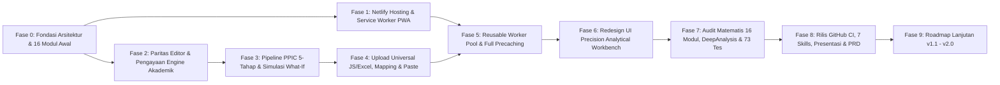
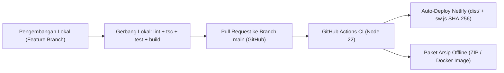

# Project Planning & Implementation Roadmap — OmniQM Studio

| Atribut | Nilai |
| :--- | :--- |
| **Nama Proyek** | **OmniQM Studio** — Aplikasi Web POM-QM & PPIC Paralel (16 Modul) |
| **Versi Rencana** | `1.0.0` (Realisasi Fase 0–8 + Roadmap Lanjutan v1.1–v2.0) |
| **Metodologi** | *Iterative-Incremental* & *Verification-Driven Development (VDD)* |
| **Repositori** | [Oceppppp/omniqm-studio](https://github.com/Oceppppp/omniqm-studio) |
| **Dokumen Terkait** | [`docs/PRD.md`](PRD.md) · [`docs/ARCHITECTURE.md`](ARCHITECTURE.md) · [`docs/DESIGN_SYSTEM.md`](DESIGN_SYSTEM.md) |

---

## 1. Ringkasan Rencana Proyek & Strategi Eksekusi

Dokumen ini merinci rencana kerja menyeluruh (*Work Breakdown Structure*), urutan fase, ketergantungan jalur kritis, pembagian peran beserta pemetaan *Agent Skills*, strategi pengujian (*Quality Gates*), manajemen risiko, serta peta jalan pengembangan pasca-v1.0 untuk **OmniQM Studio**.

### 1.1 Prinsip Eksekusi Teknis
1. **Verification-Driven Delivery:** Setiap fase hanya dinyatakan selesai (*Done*) bila seluruh 4 gerbang mutu otomatis lulus tanpa pengecualian:
   - `npm run lint` (`oxlint` — 0 warning, 0 error)
   - `npx tsc --noEmit` (TypeScript strict mode — 0 error)
   - `npm test` (Vitest unit, parser, PWA, dan audit matematis — 100% lulus)
   - `npm run build` (kompilasi produksi + stempel Service Worker sukses)
2. **Pemisahan Lapisan Ketat (*Clean Boundaries*):** Engine matematika di `src/engines/` wajib bebas dari React/DOM agar dapat berjalan identik di Web Worker, thread utama, maupun runner pengujian Node/Vitest.
3. **Zero-Regression Mathematical Integrity:** Setiap penambahan algoritma atau perbaikan bug matematis wajib dikunci oleh pengujian regresi independen di `tests/engines/`.

### 1.2 Stack Teknologi & Toolchain Terkunci

| Lapisan | Teknologi & Versi (`package.json`) | Peran dalam Sistem |
| :--- | :--- | :--- |
| **UI & Framework** | React `19.3.1`, TypeScript `~7.0.2`, Lucide React `1.74.0` | Antarmuka modular *Precision Analytical Workbench* |
| **Build & Bundler** | Vite `8.3.6`, `@vitejs/plugin-react` `6.1.2` | Kompilasi ESM, code-splitting, plugin stempel `sw.js` |
| **Spreadsheet IO** | SheetJS `xlsx` `0.18.5` | Baca/tulis workbook `.xlsx`/`.xls` multi-sheet di browser |
| **Konkurensi** | Native Module Web Workers (`solver.worker.ts`) | Eksekusi paralel 16 modul tanpa memblokir UI |
| **Quality & Testing** | Vitest `5.1.0`, Oxlint `1.90.0`, GitHub Actions (Node 22) | Suite 73 tes otomatis, static analysis, CI otomatis |
| **Hosting & Distribusi** | Netlify (`netlify.toml`), Service Worker PWA, Docker/Nginx | Auto-deploy GitHub → Netlify & eksekusi 100% offline |

---

## 2. Peta Jalan & Ketergantungan Antar-Fase

---

## 3. Work Breakdown Structure (WBS) per Fase

### Fase 0 — Inisiasi, Fondasi Arsitektur 4-Lapisan & Katalog 16 Modul Baseline `[SELESAI]`
- **Tujuan:** Membangun kerangka aplikasi React + TypeScript + Vite dengan pemisahan 4 lapisan dan 16 engine POM-QM dasar yang dapat dijalankan bersama.
- **Deliverables Utama:**
  - Kontrak tipe domain & workspace (`src/core/types/module.types.ts`, `workspace.types.ts`, `chart.types.ts`).
  - Registri terpusat 16 modul (`src/core/registry/moduleRegistry.ts`) dan helper numerik (`src/core/math/matrix.ts`, `distributions.ts`).
  - Implementasi awal 16 solver di `src/engines/` + `WorkspaceProvider` (`src/store/workspaceStore.tsx`).
  - Shell antarmuka (`AppShell.tsx`, `TopBar.tsx`, `ModuleCatalog.tsx`, `BatchDashboard.tsx`, `ResultView.tsx`).

### Fase 1 — Konfigurasi Hosting Netlify & Service Worker Anti-Stale-Cache `[SELESAI]`
- **Tujuan:** Menjamin aplikasi dapat di-deploy otomatis ke Netlify tanpa masalah SPA 404 maupun cache Service Worker usang pasca pembaruan.
- **Deliverables Utama:**
  - Konfigurasi [`netlify.toml`](../netlify.toml), [`public/_headers`](../public/_headers), [`public/_redirects`](../public/_redirects), dan [`.nvmrc`](../.nvmrc) (Node 22).
  - Pembaruan [`public/sw.js`](../public/sw.js): strategi *Network-First* untuk HTML, *Cache-First* untuk `/assets/*`, `skipWaiting()` + `clients.claim()`, pembersihan cache lama saat `activate`.
  - Pengujian otomatis konfigurasi hosting & SW di [`tests/pwa/hostingAndSw.test.ts`](../tests/pwa/hostingAndSw.test.ts) (4 tes).

### Fase 2 — Paritas Kontrol Editor & Pengayaan Engine Kuantitatif Akademik `[SELESAI]`
- **Tujuan:** Melengkapi seluruh parameter editor agar sepadan dengan POM-QM akademik serta memperkaya kedalaman metode pada modul kunci PPIC & Riset Operasi.
- **Deliverables Utama:**
  - **Paritas Editor:** Penambahan/penghapusan dinamis baris/kolom/periode/BOM di [`MrpEditor.tsx`](../src/ui/components/editors/MrpEditor.tsx), [`AggregatePlanningEditor.tsx`](../src/ui/components/editors/AggregatePlanningEditor.tsx), [`OptimizationEditors.tsx`](../src/ui/components/editors/OptimizationEditors.tsx), [`OperationsEditors.tsx`](../src/ui/components/editors/OperationsEditors.tsx), dan [`PlanningEditors.tsx`](../src/ui/components/editors/PlanningEditors.tsx).
  - **MRP Multi-Parent & 5 Lot-Sizing:** `L4L`, `FOQ`, `POQ`, `EOQ`, `Silver-Meal` + *Low-Level Coding* & komparasi total biaya otomatis.
  - **Forecasting Lanjutan:** Seasonal Decomposition / Holt-Winters (*Additive* & *Multiplicative*) + *Auto-Tune* $(\alpha, \beta)$.
  - **LP Ranging & Simplex Steps:** Tabel sensitivitas koefisien Z & RHS + riwayat iterasi simpleks.
  - **PERT/CPM Crashing & AON:** Analisis *Time-Cost Trade-Off* + komponen [`SvgNetworkChart.tsx`](../src/ui/components/charts/SvgNetworkChart.tsx).
  - **Aggregate Planning Optimal:** Formulasi Transportation Optimal LP (Bowman).
  - Pengujian di [`tests/engines/phase2Enhancements.test.ts`](../tests/engines/phase2Enhancements.test.ts) (6 tes).

### Fase 3 — Pipeline Integrasi PPIC 5-Tahap (DAG) & Simulasi *What-If* `[SELESAI]`
- **Tujuan:** Mengubah aplikasi dari sekadar kalkulator batch menjadi lingkungan simulasi rantai pasok terintegrasi.
- **Deliverables Utama:**
  - Penjadwalan topologis Kahn & deteksi siklus di [`pipelineResolver.ts`](../src/core/pipeline/pipelineResolver.ts) dengan dukungan injeksi skalar dan deret multi-periode.
  - Preset 1-klik **Rantai PPIC 5-Tahap** (`FC → AP → MR → IN → SC`) di [`sampleDatasets.ts`](../src/io/templates/sampleDatasets.ts).
  - Visualisasi DAG klikable di [`SvgPipelineDag.tsx`](../src/ui/components/charts/SvgPipelineDag.tsx) dan sinkronisasi state otomatis di [`PipelineLinker.tsx`](../src/ui/components/PipelineLinker.tsx).
  - Fitur *Baseline Snapshot*, duplikasi job, dan tabel perbandingan delta (`Δ`, `%`) di [`BatchDashboard.tsx`](../src/ui/components/BatchDashboard.tsx).

### Fase 4 — Universal Data Ingestion (Semua File JS + Excel/CSV/JSON), Paste & Laporan Audit `[SELESAI]`
- **Tujuan:** Menghilangkan friksi input data dari format apa pun secara aman di sisi klien.
- **Deliverables Utama:**
  - **Zero-`eval()` Safe JS/JSON5 Parser ([`jsDataParser.ts`](../src/io/parsers/jsDataParser.ts)):** Menerima semua ekstensi `.js`/`.mjs`/`.cjs`/`.json`/teks dengan nama file bebas, mendukung ESM, CJS, `window`/`globalThis`, UMD/JSONP/IIFE, array 1D/2D/objek, dan CSV tertanam; terverifikasi di [`tests/io/jsUpload.test.ts`](../tests/io/jsUpload.test.ts) (6 tes).
  - **Interactive Column Mapping Wizard ([`columnMapping.ts`](../src/io/parsers/columnMapping.ts)):** Memungkinkan penyesuaian baris header dan kolom secara interaktif sebelum impor.
  - **Direct Copy-Paste `Ctrl+V` ([`gridPaste.ts`](../src/ui/utils/gridPaste.ts)):** Tempel matriks langsung dari Excel/Google Sheets ke tabel editor.
  - **Audit Steps & Print CSS:** Akordion *"Langkah Perhitungan & Rumus"* pada 16 modul dengan dukungan cetak PDF rapi (`@media print`).
  - **Dataset Sampel Siap Uji:** Folder [`samples/`](../samples/) (Workbook 16 sheet, 3 CSV, 1 bundel `.omniqm.json`, 1 file `contoh_upload_bebas.js`).

### Fase 5 — Optimasi *Reusable Web Worker Pool* & *Full Bundle Precaching* `[SELESAI]`
- **Tujuan:** Meminimalkan overhead pembuatan thread worker serta menjamin 100% aset aplikasi dan worker tersedia offline setelah kunjungan pertama.
- **Deliverables Utama:**
  - Pool worker persisten (`2..8` slot, timeout `15.000 ms`, antrean FIFO, auto-recovery) di [`workerPool.ts`](../src/workers/workerPool.ts).
  - Plugin Vite `omniqmServiceWorkerPlugin` di [`vite.config.ts`](../vite.config.ts) yang menanamkan SHA-256 `buildId` dan seluruh daftar file `/assets/*` (termasuk `solver.worker-*.js`) ke `dist/sw.js`.

### Fase 6 — Redesign UI *Precision Analytical Workbench* (Anti-AI-Slop) `[SELESAI]`
- **Tujuan:** Meningkatkan kematangan desain produk agar setara perangkat lunak analitik rekayasa profesional dengan hierarki visual tegas dan kepadatan informasi terukur.
- **Deliverables Utama:**
  - Dokumentasi standar desain di [`docs/DESIGN_SYSTEM.md`](DESIGN_SYSTEM.md) (5 prinsip desain + daftar larangan *anti-slop*).
  - Refactor CSS berlapis di [`src/styles/`](../src/styles/) (`tokens.css` → `base.css` → `layout.css` → `components.css`): 3 bidang permukaan, aksen tunggal Prussian Sapphire (`#113F67`), `Plus Jakarta Sans` + `JetBrains Mono` `tabular-nums`, *Hairline KPI Grid*.
  - Eliminasi duplikasi kartu di `BatchDashboard` melalui *Master Batch Matrix* + ekspansi *inline drawer*, label katalog ringkas, dan kalibrasi ulang 6 komponen grafik SVG.

### Fase 7 — Audit Matematis Menyeluruh (20+ Perbaikan Bug), *Deep Analysis* & Suite 73 Tes `[SELESAI]`
- **Tujuan:** Memverifikasi kebenaran matematis seluruh 16 engine terhadap kasus sudut (*edge cases*) dan melengkapi setiap modul dengan analisis manajerial mendalam.
- **Perbaikan Matematis Kritis yang Diselesaikan (Ringkasan Audit):**
  - `LP`: Shadow price eksak untuk kendala `=` via $y = c_B B^{-1}$.
  - `IP`: Best-First Branch-and-Bound + perhitungan *Integrality Gap* akurat.
  - `TR`: Detektor siklus MODI berbasis *Union-Find* untuk matriks *degenerate*.
  - `PM`: Enumerasi semua jalur kritis paralel, variansi jalur maksimum PERT, dan *multi-node crashing cut*.
  - `FC`: Normalisasi bobot WMA saat jendela terpotong + perhitungan OLS $R^2$.
  - `IN`: Perhitungan `totalInventoryCost` inklusif biaya pembelian pada Quantity Discount.
  - `WL`: Formula rekursif tahan *factorial overflow* pada M/M/s & M/M/1/K + pelestarian `timeUnit`.
  - `BE`: Margin of Safety (%), Degree of Operating Leverage (DOL), dan interval dominasi Crossover.
  - `DA`: Penyesuaian arah & header `Minimin`/`Minimax` untuk tabel biaya (`isCostTable`).
  - `QC`: Konstanta ASTM lengkap $n=2..25$, batas $p$-Chart $[0,1]$, validasi `USL > LSL`, Western Electric Run Rule, & PPM.
  - `NM`: Bellman-Ford dengan deteksi siklus negatif, MST hanya pada node ber-edge, verifikasi Max-Flow = Min-Cut.
  - `MK`: Penanganan rantai *all-absorbing*, guard matriks $(I-Q)$ singular, dan proyeksi absorpsi dari $\pi_0$.
  - `MR`: Deteksi rambatan peringatan *past-due* lintas level BOM.
  - `AP`: Penalti *shortage* Bowman LP akurat $(T-t) \cdot b$.
  - `SC`: Penambahan metrik *Max Tardiness* dan Gantt Chart Johnson 2-Mesin.
  - `IO Mapper`: Default sense `'min'` untuk `TR`/`AS` serta *NaN guards*.
- **Deliverables Deep Analysis & Pengujian:**
  - Kontrak `DeepAnalysis` terpasang di seluruh 16 engine, dirender di `ResultView.tsx`, serta terekspor di Excel/CSV/Print.
  - Suite [`tests/engines/mathAuditAndAnalysis.test.ts`](../tests/engines/mathAuditAndAnalysis.test.ts) (36 tes baru → total **73/73 tes lulus**).

### Fase 8 — Publikasi GitHub, CI Otomatis, 7 Project Skills, Presentasi & Dokumentasi PRD/Planning `[SELESAI]`
- **Tujuan:** Memastikan proyek siap pakai, terdokumentasi utuh, dapat direproduksi tim lain, dan siap dipresentasikan.
- **Deliverables Utama:**
  - Repositori publik [Oceppppp/omniqm-studio](https://github.com/Oceppppp/omniqm-studio) lengkap dengan `LICENSE` (MIT), `CONTRIBUTING.md`, `README.md`, dan 3 tangkapan layar resolusi tinggi (`docs/screenshots/`).
  - Pipeline CI otomatis di [`.github/workflows/ci.yml`](../.github/workflows/ci.yml) (lulus ~21 detik di Node 22).
  - 7 *Project Skills* terkustomisasi di `.agents/skills/` untuk standar kontribusi & pemeliharaan.
  - Deck presentasi sistem 12 slide (Google Slides) + arsip distribusi offline `OmniQM-Studio-UAS-PPIC.zip`.
  - Dokumen resmi [`docs/PRD.md`](PRD.md) dan [`docs/PROJECT_PLANNING.md`](PROJECT_PLANNING.md).

### Fase 9 — Roadmap Pengembangan Lanjutan (`v1.1` – `v2.0`) `[DIRENCANAKAN]`
- **`v1.1` (Pengayaan Analisis & Pelaporan):**
  - *Parametric LP Slider* interaktif untuk menggeser RHS/koefisien objektif secara real-time di grafik 2D.
  - Ekspor laporan PDF multi-modul terpadu (cover, ringkasan eksekutif, grafik vektor, & seluruh `DeepAnalysis`).
  - Penambahan 3 preset industri siap pakai (Kapasitas Rumah Sakit, Jaringan Logistik E-Commerce, Lini Manufaktur Job-Shop).
- **`v1.2` (Ekspansi Modul Kuantitatif):**
  - Modul **Monte Carlo Simulation** (distribusi Normal, Triangular, Uniform, Poisson).
  - Modul **Facility Location** (*Center of Gravity*, *Factor Rating*, *Load-Distance*).
  - Modul **Assembly Line Balancing** (*Ranked Positional Weight* & efisiensi stasiun kerja).
- **`v2.0` (Skala Industri & Kolaborasi Opsional):**
  - Integrasi opsional WASM MILP solver (*HiGHS*) untuk model IP/LP ratusan hingga ribuan variabel.
  - Sinkronisasi workspace berbasis tautan terenkripsi atau ekspor/impor langsung Google Sheets.

---

## 4. Jadwal Milestone, Dependensi & Jalur Kritis

| Fase | Milestone / Deliverable Gate | Estimasi Effort | Dependensi | Status | Jalur Kritis |
| :--- | :--- | :--- | :--- | :--- | :---: |
| **Fase 0** | Fondasi 4-lapisan & 16 engine baseline berjalan | Sprint 1 (3 hari) | — | Selesai | **Ya** |
| **Fase 1** | Netlify config + SW anti-stale-cache + 4 tes PWA | Sprint 1 (1 hari) | Fase 0 | Selesai | Tidak |
| **Fase 2** | Paritas editor + 5 pengayaan engine akademik | Sprint 2 (3 hari) | Fase 0 | Selesai | **Ya** |
| **Fase 3** | DAG Pipeline 5-Tahap PPIC + *What-If Snapshot* | Sprint 2 (2 hari) | Fase 2 | Selesai | **Ya** |
| **Fase 4** | Safe JS Parser + Column Mapping + Paste `Ctrl+V` | Sprint 3 (3 hari) | Fase 3 | Selesai | **Ya** |
| **Fase 5** | Reusable Worker Pool + Full Bundle Precaching | Sprint 3 (1 hari) | Fase 1, 4 | Selesai | Tidak |
| **Fase 6** | Redesign UI *Precision Analytical Workbench* | Sprint 4 (2 hari) | Fase 5 | Selesai | Tidak |
| **Fase 7** | Audit Matematis 16 modul + `DeepAnalysis` + 73 tes | Sprint 4 (3 hari) | Fase 4, 6 | Selesai | **Ya** |
| **Fase 8** | GitHub CI + 7 Skills + Slides + PRD & Planning | Sprint 5 (2 hari) | Fase 7 | Selesai | **Ya** |
| **Fase 9** | Ekspansi v1.1 – v2.0 (Parametric, Monte Carlo, WASM) | Pasca-v1.0 | Fase 8 | Rencana | — |

**Jalur Kritis (*Critical Path*) v1.0.0:** `Fase 0 → Fase 2 → Fase 3 → Fase 4 → Fase 7 → Fase 8` (total 16 hari kerja efektif; Fase 1, Fase 5, dan sebagian Fase 6 dapat berjalan paralel dengan jalur utama).

---

## 5. Matriks Peran, Tanggung Jawab & Pemetaan Agent Skills

Untuk menjaga kualitas pengembangan berkelanjutan (baik oleh tim manusia maupun agen AI), setiap peran dipetakan langsung ke *Project Skills* di folder `.agents/skills/`:

| Peran | Tanggung Jawab Utama | Skill Terkait (`.agents/skills/`) | Artefak Kepemilikan |
| :--- | :--- | :--- | :--- |
| **Product & PPIC Domain Owner** | Spesifikasi kebutuhan, validasi rantai PPIC, kurasi dataset sampel & dokumentasi produk. | `antigravity-skill-audit` | `docs/PRD.md`, `docs/PROJECT_PLANNING.md`, `samples/` |
| **OR / Solver Engineer** | Pengembangan 16 engine kuantitatif murni, optimasi numerik, `auditSteps`, dan `DeepAnalysis`. | `or-module-development` | `src/engines/*.ts`, `src/core/math/` |
| **Mathematical QA Engineer** | Perancangan uji *edge-case* independen terhadap buku teks standar (Heizer, Taha, Montgomery). | `mathematical-validation` | `tests/engines/*.test.ts` |
| **Data Ingestion & IO Engineer** | Parser Excel/CSV/JSON/Safe JS tanpa `eval()`, deteksi otomatis, column mapping, & exporter. | `data-import-validation` | `src/io/parsers/`, `src/io/exporters/`, `tests/io/` |
| **Frontend / Design System Engineer** | Antarmuka React 19, aksesibilitas, 6 grafik SVG, CSS tokens, dan penegakan standar *anti-slop*. | `frontend-ui` | `src/ui/`, `src/styles/`, `docs/DESIGN_SYSTEM.md` |
| **System Architect** | Menjaga batas 4 lapisan, isolasi Web Worker Pool, integritas DAG, dan strategi PWA/Netlify. | `architecture-review` | `src/core/pipeline/`, `src/workers/`, `docs/ARCHITECTURE.md` |
| **Release & DevOps Engineer** | Menjalankan gerbang rilis (lint, tsc, vitest, build, live Chromium), CI GitHub, & deploy Netlify. | `qa-release` | `.github/workflows/ci.yml`, `netlify.toml`, `vite.config.ts` |

---

## 6. Rencana Jaminan Kualitas (*Quality Assurance Plan*)

### 6.1 Piramida Pengujian 5 Tingkat
1. **Static Code Analysis:** `npm run lint` (`oxlint`) memeriksa seluruh file TypeScript/TSX untuk potensi bug, variabel tidak terpakai, dan pola React tidak aman.
2. **Strict Type Verification:** `npx tsc --noEmit` & `tsc -b` memastikan 100% kepatuhan kontrak tipe lintas lapisan.
3. **Automated Test Suite (`npm test` — 8 berkas, 73 tes):**

| Berkas Tes | Jumlah Tes | Cakupan Pengujian |
| :--- | :---: | :--- |
| [`tests/engines/mathAuditAndAnalysis.test.ts`](../tests/engines/mathAuditAndAnalysis.test.ts) | 36 | Audit edge-case seluruh 16 modul + verifikasi struktur `DeepAnalysis` 16/16 modul |
| [`tests/engines/phase2Enhancements.test.ts`](../tests/engines/phase2Enhancements.test.ts) | 6 | MRP 5 lot-sizing, Forecasting Seasonal/Auto-Tune, LP Ranging, CPM Crashing, Bowman LP, PPIC DAG |
| [`tests/engines/planning.test.ts`](../tests/engines/planning.test.ts) | 6 | Decision Analysis, Quality Control SPC, Network Models, Markov, MRP, Aggregate Planning & Scheduling |
| [`tests/io/jsUpload.test.ts`](../tests/io/jsUpload.test.ts) | 6 | Safe JS Parser (ESM, CJS, UMD/JSONP, multi-export, embedded CSV, bebas `eval()`) |
| [`tests/engines/optimization.test.ts`](../tests/engines/optimization.test.ts) | 5 | Linear Programming, Integer Programming, Transportation, Assignment |
| [`tests/engines/operations.test.ts`](../tests/engines/operations.test.ts) | 5 | Project Management, Forecasting, Inventory, Waiting Lines, Break-Even |
| [`tests/io/parsers.test.ts`](../tests/io/parsers.test.ts) | 5 | Deteksi & pemetaan Excel multi-sheet, CSV, JSON, dan Column Mapping |
| [`tests/pwa/hostingAndSw.test.ts`](../tests/pwa/hostingAndSw.test.ts) | 4 | Validasi `netlify.toml`, `_headers`, `_redirects`, dan pola cache `sw.js` |

4. **Production Bundle & SW Verification:** `npm run build` memverifikasi pembuatan `dist/assets/*`, pemisahan chunk vendor, dan stempel SHA-256 pada `dist/sw.js`.
5. **Live Browser Verification & CI Gate:** Verifikasi runtime di Chromium headless (eksekusi batch 16 modul `< 300 ms`, 0 console/page error) serta eksekusi otomatis [`.github/workflows/ci.yml`](../.github/workflows/ci.yml) di setiap `push`/`pull_request` ke `main`.

---

## 7. Manajemen Risiko & Strategi Mitigasi (*Risk Register*)

| ID | Risiko | Probabilitas | Dampak | Strategi Mitigasi Terimplementasi | Status |
| :--- | :--- | :---: | :---: | :--- | :--- |
| **R-01** | Degenerasi, *cycling*, atau *factorial overflow* numerik (Simplex, MODI, Erlang-C, Markov). | Sedang | Tinggi | Aturan Bland pada Simplex, Union-Find pada MODI, rasio rekursif tahan overflow pada Erlang-C, guard singularitas $(I-Q)$, dan 36 tes audit matematis. | Termitigasi |
| **R-02** | Pengguna melihat versi aplikasi usang pasca deploy Netlify (*stale Service Worker cache*). | Tinggi | Tinggi | Header `no-cache, no-store` untuk `/index.html` & `/sw.js`, stempel hash SHA-256 otomatis di `vite.config.ts`, *Network-First* untuk HTML, dan pembersihan cache lama saat `activate`. | Termitigasi |
| **R-03** | Risiko keamanan (XSS/eksekusi skrip berbahaya) saat pengguna mengunggah file `.js` bebas. | Sedang | Kritis | Parser pasif (`jsDataParser.ts`) berbasis tokenizer + recursive-descent tanpa `eval()`/`new Function()` dan batas `MAX_TOKENS = 200.000`. | Termitigasi |
| **R-04** | Format kolom/header Excel atau CSV pengguna tidak sesuai template standar. | Tinggi | Sedang | Deteksi heuristik multi-sinyal (`fileDetector.ts`), *Interactive Column Mapping Wizard*, dan *NaN guards* pada `moduleMapper.ts`. | Termitigasi |
| **R-05** | Siklus dependensi (*circular link*) pada Pipeline DAG antar-modul menyebabkan loop tak hingga. | Rendah | Tinggi | Algoritma Kahn mendeteksi `hasCycle`, memberi peringatan jelas kepada pengguna, dan tetap menyelesaikan modul tersisa secara deterministik. | Termitigasi |
| **R-06** | Main-thread browser *freeze* saat batch 16 modul atau Branch-and-Bound IP besar dijalankan. | Sedang | Sedang | Isolasi seluruh solver pada *Reusable Web Worker Pool* dengan timeout `15.000 ms` per tugas dan batas eksplorasi node aman di IP. | Termitigasi |
| **R-07** | Inkonsistensi angka antara UI layar, mode cetak/PDF, dan berkas ekspor Excel/CSV. | Rendah | Sedang | *Single Source of Truth* dari objek `ModuleExecutionResult` (termasuk `DeepAnalysis` & `tables`) untuk seluruh kanal tampilan dan ekspor. | Termitigasi |

---

## 8. Strategi Rilis, Deployment & Pemeliharaan

### 8.1 Alur Rilis (*Release Pipeline*)

### 8.2 Checklist *Definition of Done* (DoD) Sebelum Rilis
- [ ] Seluruh perubahan kode mematuhi pemisahan 4 lapisan dan `docs/DESIGN_SYSTEM.md`.
- [ ] `npm run lint` dan `npx tsc --noEmit` menghasilkan **0 error & 0 warning**.
- [ ] `npm test` lulus **100%** termasuk pengujian regresi untuk setiap fitur atau perbaikan bug baru.
- [ ] `npm run build` sukses dan `dist/sw.js` memuat seluruh aset bundle terbaru.
- [ ] Dokumentasi terkait (`README.md`, `docs/PRD.md`, `docs/PROJECT_PLANNING.md`) diperbarui bila ada perubahan cakupan atau API.
- [ ] GitHub Actions CI pada branch `main` berstatus hijau sebelum menandai rilis versi semantik (`vMAJOR.MINOR.PATCH`).
